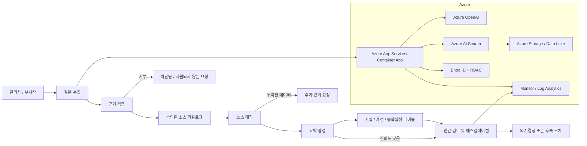

<!-- markdownlint-disable-file -->

# relationship-manager-fsi 아키텍처 노트

> 인간 검토용 초안입니다. 이 아티팩트는 워크숍에 적합하고 증거 중심의 경영관리 분석 에이전트에 대한 구현 계획을 솔루션 설계와 연결합니다. 승인된 연구, PRD, UX 초안, 백로그 계획에 범위를 한정하며, 실제 프로덕션 또는 Marketplace 준비 상태를 주장하지 않습니다.

## 1. 솔루션 요약
대상 솔루션은 경영진과 부서장용 의사결정 지원 에이전트입니다. 승인된 운영 증거를 수집하고, 사용자의 질문을 관련 소스 데이터에 매핑하며, 예외 및 경향을 감지한 뒤, 사실, 가정, 미해결 질문을 분리해 짧은 요약을 생성합니다. 사용자는 어떤 의사결정의 최종 권한을 가지며, 운영적 조치가 권장되기 전에 인간 검토가 반드시 필요합니다.

## 2. 구현 단계별 매핑

### 단계 1: 근거 검증 게이트와 신뢰 정책
솔루션 접근 방식:
- 승인된 근거 원천과 지원 파일 형식의 소규모 허용 목록을 설정합니다.
- 사전 검증 단계로 승인되지 않았거나 민감한 입력을 거부합니다.
- 답변을 구성하기 전에 각 사실을 확인됨, 추론됨, 가정, 미확인으로 태깅합니다.

주요 트레이드오프:
- 근거 범위를 좁히면 신뢰성과 정보 유출 위험 감소에 도움이 되지만, 초기 데모에서 인사이트 범위는 줄어듭니다.
- 엄격한 게이트는 오판을 방지하지만 분석 시작 전 UX에 약간의 부담을 추가합니다.

아키텍처 패턴:
- 검색 및 추론 계층 앞에 정책 서비스 + 근거 카탈로그 + 검증 가드레일을 배치합니다.

### 단계 2: 질문 수집 및 소스 매핑
솔루션 접근 방식:
- 자연어 프롬프트를 최소 구조화 폼(기간, KPI 초점, 부서 또는 기능, 관련 의사결정 맥락)과 함께 수용합니다.
- 메타데이터, 이름, 비즈니스 맥락을 바탕으로 질문을 승인된 소스 파일 또는 데이터 테이블에 매핑합니다.
- 합성 작업이 시작되기 전에 누락되거나 지원되지 않는 정보를 노출합니다.

주요 트레이드오프:
- 가이드형 폼은 신뢰성을 높이지만 자유로운 탐색을 줄입니다.
- 풍부한 소스 매핑은 품질을 높이지만 메타데이터 관리와 소스 카탈로그 설계가 더 필요합니다.

아키텍처 패턴:
- 입력 오케스트레이션 서비스와 소스 인덱스 조회, 컨텍스트 선택 계층을 결합합니다.

### 단계 3: 요약 합성 및 이상 탐지
솔루션 접근 방식:
- 주요 편차, 추세, 예외를 짧은 경영 브리프로 요약합니다.
- 다음 섹션을 생성합니다: 이슈, 근거, 영향, 가정, 위험, 다음 검토 단계.
- “사실”, “가정”, “신뢰도 낮음”, “검토 필요”와 같은 명시적 레이블을 사용합니다.

주요 트레이드오프:
- 강한 서술형 요약은 경영진에게 이해하기 쉬우나, 근거가 약하면 과신 위험이 있습니다.
- 짧은 출력은 속도와 가독성을 높이지만, 요약 구조를 잘못 설계하면 미묘한 맥락이 숨겨질 수 있습니다.

아키텍처 패턴:
- 최종 렌더링 전에 강제적인 근거 분리 단계를 포함하는 검색 + 오케스트레이션 + 요약 워크플로우입니다.

### 단계 4: 인간 검토 및 에스컬레이션
솔루션 접근 방식:
- 어떤 권고도 실행 가능한 지침으로 간주되기 전에 승인 게이트를 둡니다.
- 고위험, 정책 민감, 낮은 신뢰도 항목을 근거 추적과 함께 인간 검토자에게 에스컬레이션합니다.
- 사용된 근거와 핵심 가정이 남는 감사 추적을 유지합니다.

주요 트레이드오프:
- 인간 검토는 신뢰와 안전성을 높이지만 워크플로우에 시간이 추가됩니다.
- 에스컬레이션은 거버넌스에 필수적이지만 데모 환경에서는 게이트가 너무 제한적이면 느리게 느껴질 수 있습니다.

아키텍처 패턴:
- 의사결정 체크포인트 서비스 + 검토 큐 + 서명된 요약 기록입니다.

### 단계 5: 검증 및 준비 상태
솔루션 접근 방식:
- 요약 시간, 검토 수용률, 에스컬레이션 비율, 근거 커버리지를 측정합니다.
- 실제 경영진이나 분석가와 사용자 경험을 검증한 뒤 더 넓은 롤아웃을 고려합니다.
- 게시 준비 상태는 제품 실현 가능성과 분리해 임시 상태로 유지합니다.

주요 트레이드오프:
- 제품 검증은 필수적이지만 초기 준비 상태를 과도하게 주장하면 잘못된 기대가 생길 수 있습니다.
- 통제된 검증 루프는 느리지만 약하거나 안전하지 않은 경험의 출시 위험을 줄입니다.

아키텍처 패턴:
- 텔레메트리와 거버넌스 검토 서비스이며, 릴리즈 인증이 아니라 제품 품질 증거를 제공하는 구조입니다.

## 3. 클라우드 아키텍처

### 권장 아키텍처
- 사용자 경험: Teams, Outlook, Copilot 등 Microsoft 365 앱을 활용해 의사결정 지원 및 검토 대화를 수행합니다.
- 애플리케이션 계층: 세션 상태, 근거 검증, 요약 생성용 소형 API 계층을 포함하는 Azure 호스팅 오케스트레이션 서비스입니다.
- AI 계층: 구조화된 추론, 요약, 프롬프트 오케스트레이션을 위한 Azure OpenAI 또는 유사 LLM 서비스입니다.
- 데이터 계층: 합성 또는 승인된 워크숍 근거를 저장하는 Azure Storage / Data Lake 또는 승인된 관리형 스토리지와 근거 검색용 메타데이터 인덱스입니다.
- 검색 계층: 질문을 관련 소스와 증거 패키지에 매핑하는 Azure AI Search 또는 동등한 메타데이터 인덱싱 레이어입니다.
- 거버넌스 계층: 추적성과 규정 준수 검토를 위한 Entra ID, RBAC, Microsoft Purview / 데이터 분류 제어, Azure Monitor, Log Analytics입니다.

### 아키텍처 패턴 요약
이 솔루션은 의도적으로 넓게 확장하지 않고, 범위가 좁고 제어된 단일 워크플로우로 유지해야 합니다. 핵심 흐름은 다음과 같습니다.

1. 사용자가 경영 질문을 시작합니다.
2. 정책과 근거 검증 게이트가 승인된 소스와 요청을 비교 검증합니다.
3. 소스 선택 계층이 관련 파일, 지표, 제약을 해석합니다.
4. 분석 계층이 패턴, 이상, 누락된 데이터를 요약합니다.
5. 검토 계층이 실행 가능 여부를 판단하기 전에 인간 체크포인트를 강제합니다.
6. 텔레메트리 계층이 품질, 신뢰도, 사용내역을 기록합니다.

## 4. 주요 트레이드오프와 충돌 관계

### 4.1 안전성 vs 사용성
강력한 가드레일은 신뢰를 높이지만, 사용자 경험을 느리거나 제약적으로 느끼게 합니다. 적절한 균형은 승인된 저위험 요약에 대한 빠른 경로를 제공하면서, 지원되지 않거나 고위험 사례에는 강제 중단을 두는 것입니다.

### 4.2 범위 vs 정확성
넓은 근거 검색은 더 많은 컨텍스트를 제공하지만 잡음과 약한 추론의 가능성을 증가시킵니다. 좁은 근거 경계는 더 신뢰할 수 있고 검증하기 쉬우며, 워크숍 시나리오와 더 잘 맞습니다.

### 4.3 설명 가능성 vs 간결성
경영진은 짧은 답변을 원하지만 그 답변도 설명 가능해야 합니다. 최적 설계는 계층적 출력입니다: 먼저 간단한 요약을 제시하고 필요한 경우 세부사항과 근거 부록을 보여주는 방식입니다.

### 4.4 자율성 vs 인간 통제
이 제품 개념은 자율적 의사결정을 명시적으로 거부합니다. 이는 중요한 설계 트레이드오프입니다. 워크플로우는 더 신뢰할 수 있지만 완전 자율 에이전트보다 덜 자동화됩니다.

## 5. Well-Architected 고려 사항

### 신뢰성
- 누락되거나 약한 근거를 명시적 불확실성 레이블로 안전하게 처리합니다.
- 승인된 데이터 소스, 명확한 프롬프트 템플릿, 고정된 검토 단계 등으로 시스템을 가능한 한 결정적으로 유지합니다.
- 요약 생성이 안전하게 실패하도록 하여 과신된 답변 대신 검토 요청을 반환합니다.

### 보안
- 소스 데이터에 대해 최소 권한 원칙을 적용합니다.
- 근거 집합을 워크숍 안전 또는 승인된 위치로 제한합니다.
- 고객 민감 정보나 프로덕션 데이터를 저장소 로컬 파일이나 프롬프트 컨텍스트에 실수로 복사하지 못하게 합니다.
- 접근 및 추론 단계를 검토 가능한 추적 기록으로 남깁니다.

### 비용 최적화
- MVP를 좁게 유지합니다: 필요한 근거 소스, 지표, 요약만 포함합니다.
- 첫 릴리즈에서 광범위한 크로스 플랫폼 데이터 수집을 피합니다.
- 일반화된 다중 에이전트 구현보다 소규모 표적화된 오케스트레이션 흐름을 선호합니다.

### 운영 우수성
- 명확한 단계, 오류 메시지, 인간 에스컬레이션 트리거로 흐름을 표준화합니다.
- 요약 품질, 신뢰도, 검토자 수용률에 대한 텔레메트리를 기록합니다.
- 생성된 브리프가 신뢰를 낮추지 않으면서 수동 종합 시간을 줄이는지 측정합니다.

### 성능 효율성
- 관련 파일, 테이블, 문서만 Retrieval 대상으로 제한합니다.
- 여러 사용자가 비슷한 질문을 할 때 근거 메타데이터와 요약을 캐시합니다.
- 긴, 밀집된 추론 체인 대신 빠른 “요약 우선” 방식과 드릴다운 경로를 선호합니다.

### Well-Architected 거버넌스 노트
이 제품은 저장소의 근거 중심 및 인간 검토 원칙과 일치합니다. 아키텍처는 최대 자동화보다 설명 가능성, 소스 추적성, 정책 인식 처리를 우선해야 합니다.

## 6. 워크숍용 게시 가정 및 범위
이 섹션은 검토와 아키텍처 정렬을 위한 제한적 게시 관련 가정만 다룹니다. 실제 Marketplace 또는 Agent Store 런칭 계획을 의미하지는 않습니다.

### 6.1 선호 Marketplace 모델 (가정)
- 선호 고객 경험: Teams, Outlook, SharePoint, PowerPoint 워크플로우에서 의사결정 검토를 지원하는 Microsoft 365 Copilot 동반 경험입니다.
- 선호 제품 모델: 첫 워크숍 반복에서는 광범위한 자율 SaaS 플랫폼이 아니라 승인된 근거 검토와 요약 생성에 특화된 좁은 비즈니스 어시스턴트 경험입니다.
- 제품은 완전 자율 의사결정 엔진이 아니라 신뢰 중심, 인간 검토 보조형 비즈니스 경험으로 취급해야 합니다.
- 공개 Marketplace 또는 Agent Store 게시는 별도 후속 작업으로 연기되며, 최신 Microsoft 지침, Partner Center 준비 상태, 테넌트별 검증에 따라 달라집니다.

### 6.2 제품 범위 (가정)
- 제품 범위: 승인된 운영 근거에 대한 경영 검토 및 예외 브리핑입니다.
- 포함 범위: 요약, 사실/가정 분리, 미해결 질문 노출, 검토 기반 후속 권고입니다.
- 첫 워크숍 단계의 제외 범위: 자율 운영, 광범위한 데이터 수집, 승인된 소스를 넘는 고객 콘텐츠 수집, 운영 시스템에 대한 직접 기록/쓰기, 공개 게시 주장입니다.

### 6.3 제품 간 API, ID, 권한, 데이터 계약 요약
- M365 에이전트 / 클라이언트 → 오케스트레이션 API: 사용자 의도, 세션 컨텍스트, 승인된 근거 범위, 비즈니스 질문을 포함하며 응답에는 요약, 근거 참조, 신뢰도, 검토 상태가 포함됩니다.
- 오케스트레이션 API → 검색/검색 계층: 쿼리 컨텍스트, 허용된 근거 루트, 메타데이터 키, 시간 범위를 포함하며 응답에는 일치 문서 참조, 소스 식별자, 신뢰 분류가 포함됩니다.
- 오케스트레이션 API → LLM 계층: 요청 출력 스키마, 프롬프트 계약, 위험 컨텍스트, 근거 참조를 포함하며 응답에는 요약 텍스트, 사실/가정 레이블, 미해결 질문, 에스컬레이션 트리거가 포함됩니다.
- ID 및 권한 모델: 사용자 및 앱 식별은 Entra ID, 소스 접근에는 RBAC, 승인된 근거에 대한 최소 권한 부여, 백엔드 서비스 간 호출에는 관리 ID 또는 서비스 프린시펄을 사용합니다.
- 데이터 계약 가정: 각 근거 항목에는 source_id, source_type, owner, allowed_usage, trust_level, classification, timestamp가 포함되어야 하며, 각 출력에는 session_id, user_context, evidence_refs, confidence_level, decision_status, review_required flag가 포함되어야 합니다.

### 6.4 아키텍처 제약, 가정, 미해결 항목 및 담당자
- 제약 사항:
  - 승인된 근거와 워크숍 안전 입력 소스만 허용됩니다.
  - 조치나 권고가 운영적 지침으로 처리되기 전에 인간 검토가 필수입니다.
  - 프로덕션 민감 정보 또는 고객 민감 정보는 저장소 로컬 워크숍 아티팩트에 허용되지 않습니다.
  - MVP는 넓고 자율적이기보다 좁고 설명 가능해야 합니다.
- 가정:
  - Microsoft 365 Copilot 또는 동반 경험이 사용자 상호작용의 선호 프런트 도어입니다.
  - 소스 접근은 이미 테넌트 정책과 비즈니스 승인을 준수합니다.
  - 이 제품은 자율적 정책 권한이 아니라 의사결정 지원 에이전트입니다.
- 미해결 항목:
  - 정확한 타깃 비즈니스 도메인과 주요 경영 의사결정 흐름.
  - 구체적인 다운스트림 데이터 소스와 근거 접근 규칙.
  - 최종 테넌트별 배포 모델 및 환경 경계.
  - 최종 공개 경로, 오퍼 구조, 수익 모델.
- 책임 담당자 역할만:
  - 제품 소유자: 범위, 비즈니스 적합성, 의사결정 지원 가치.
  - 보안 및 거버넌스 소유자: 근거 검증, 정책 경계, 접근 승인.
  - M365 통합 소유자: Copilot 표면 통합 및 사용자 경험.
  - 데이터 소유자: 근거 소스, 분류, 소스 계약 검증.
  - 파트너 준비 소유자: 워크숍 이후 Marketplace 및 게시 후속 작업.

### 6.5 파트너 워크숍 게시 후속 단계
Marketplace 구현 계획, 오퍼 검증, 가격 책정, 수익화, Partner Center 구성, 패키징, 인증, 런칭 계획에 대한 세부 작업은 별도 후속 트랙인 “Partner Workshop Publishing Follow-Up”으로 의도적으로 미뤄둡니다. 이 노트는 워크숍 안전한 게시 가정 집합과 아키텍처 정렬에만 한정됩니다.

## 7. Microsoft IQ 및 준비 상태 검토
여기서 Microsoft IQ는 광범위한 제품 주장 또는 게시 활동 전에 필요한 거버넌스, 규정 준수, 준비 상태 검토 루프를 의미합니다.

필수 체크포인트:
- 에이전트 또는 솔루션 게시를 위한 최신 Microsoft 지침.
- 테넌트별 데이터 및 권한 제약.
- 외부 또는 내부 배포에 대한 보안 및 거버넌스 검토.
- Marketplace/스토어 경로에 대한 Partner Center 검토.
- 게시 또는 더 넓은 롤아웃 전에 신뢰, 위험, 데이터 처리 방식에 대한 인간 사인오프.

이는 MVP 프로토타입의 런칭 게이트는 아니지만, 공개 배포 주장 전 올바른 후속 게이트입니다.

## 8. Mermaid 아키텍처 다이어그램

## 9. 슬라이드용 요약
발표나 워크숍 설명을 위해 이 개념은 한 문장으로 표현할 수 있습니다:

이 솔루션은 비즈니스 질문을 받아 승인된 근거 소스를 검증하고, 관련 정보를 구조화된 요약으로 매핑하며, 사실과 가정을 레이블링한 뒤, 운영적 조치가 발생하기 전에 인간 검토자에게 결과를 전달하는 신뢰할 수 있는 경영 의사결정 지원 에이전트입니다.

시각적 스토리라인은 의도적으로 단순합니다:
- Microsoft 365에서 사용자 질문 시작
- 소스 정당성과 정책 경계 검증
- 관련 근거 검색 및 매핑
- 신뢰도와 위험 레이블이 포함된 간결 브리프 합성
- 조치 전에 인간 검토 및 에스컬레이션 요구

## 10. 구현 계획과의 연결
이 아키텍처 노트는 구현 계획 단계와 직접 연결됩니다.

- 단계 1 -> 근거 검증 게이트 및 신뢰 정책
- 단계 2 -> 질문 수집 및 소스 매핑
- 단계 3 -> 요약 합성 및 이상 탐지
- 단계 4 -> 인간 검토 및 에스컬레이션
- 단계 5 -> 검증 및 준비 상태 검토

아키텍처 설계는 신뢰, 추적성, 인간 책임을 각 단계에서 유지함으로써 제품 요구사항과 UX 초안과 일치합니다.

---

*초안 상태: 이 아키텍처 노트를 설계 기준선 또는 구현 권한으로 간주하기 전에 인간 검토가 필요합니다.*
